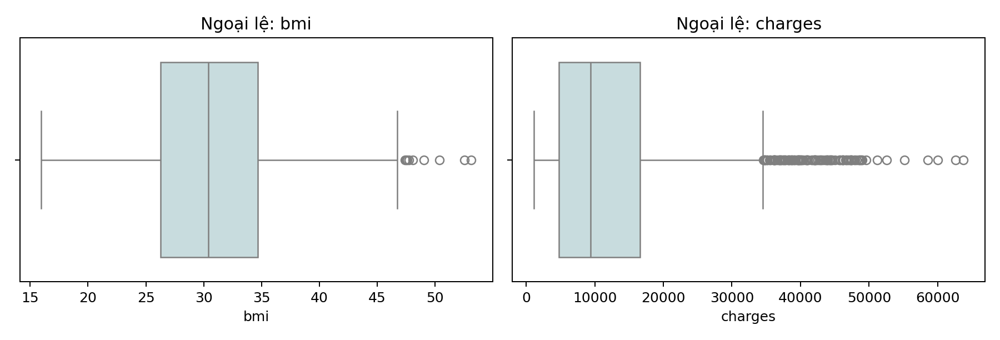
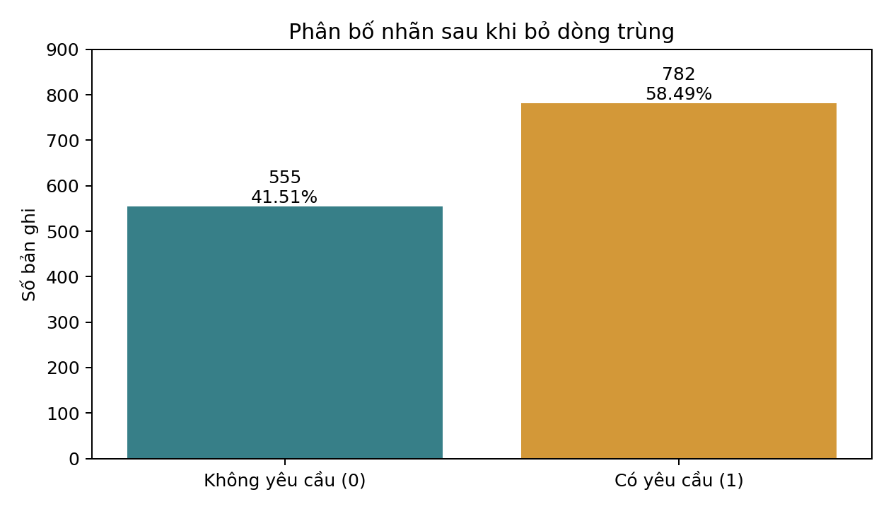
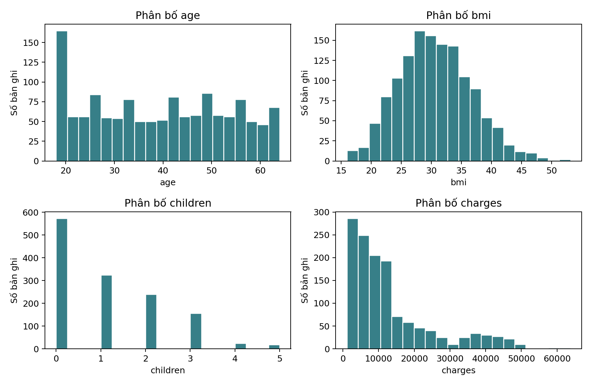
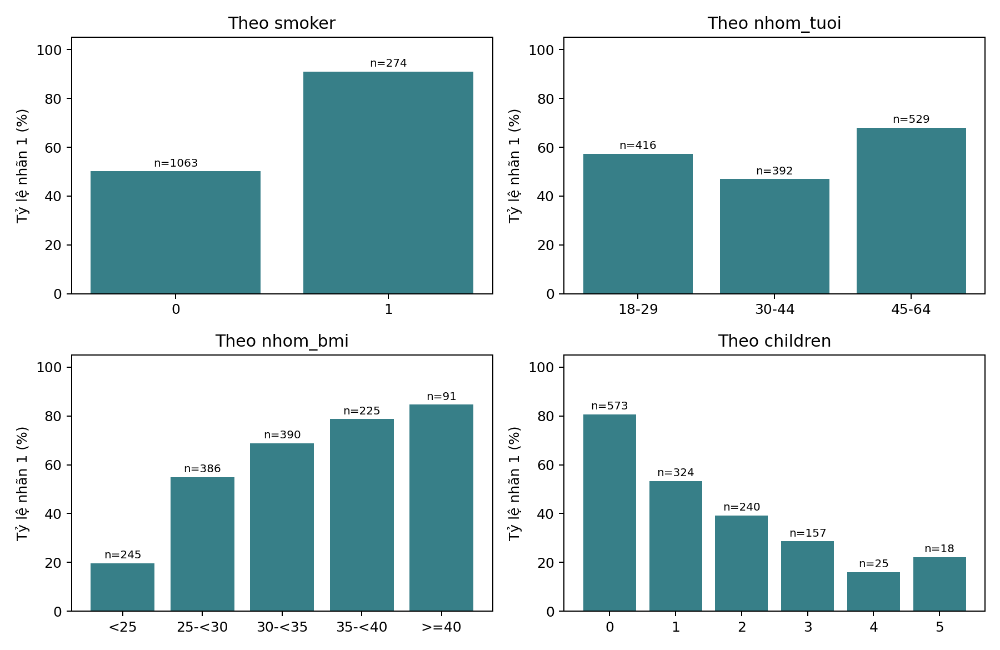
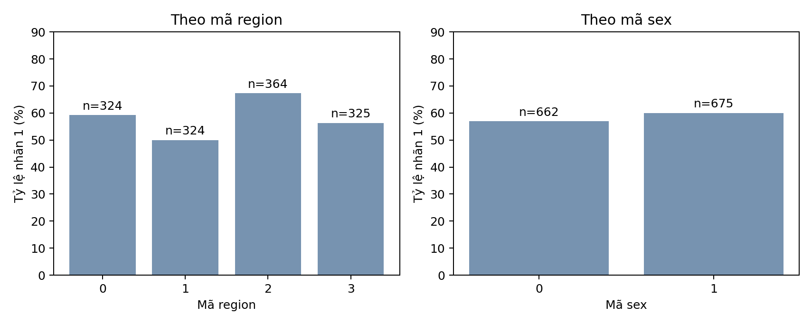
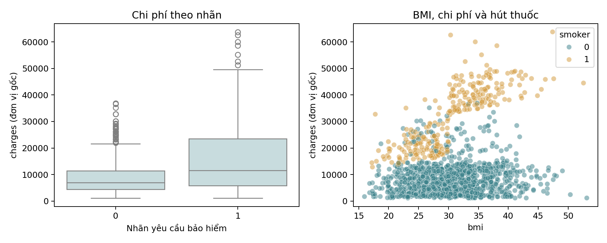
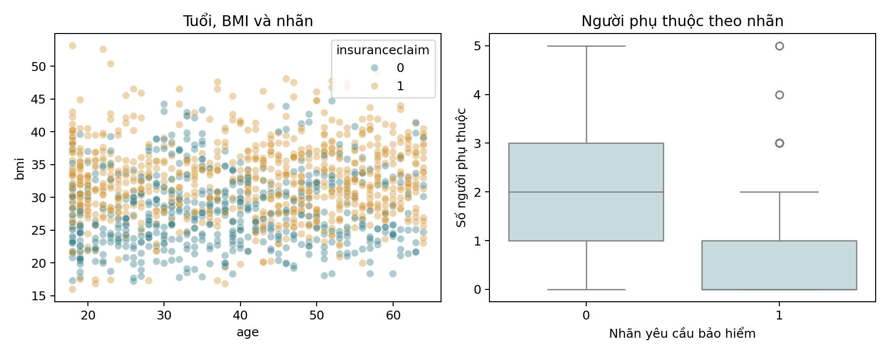
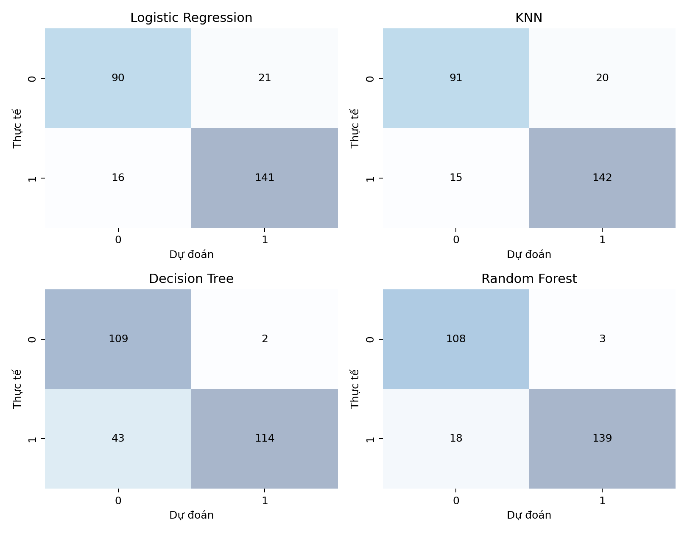
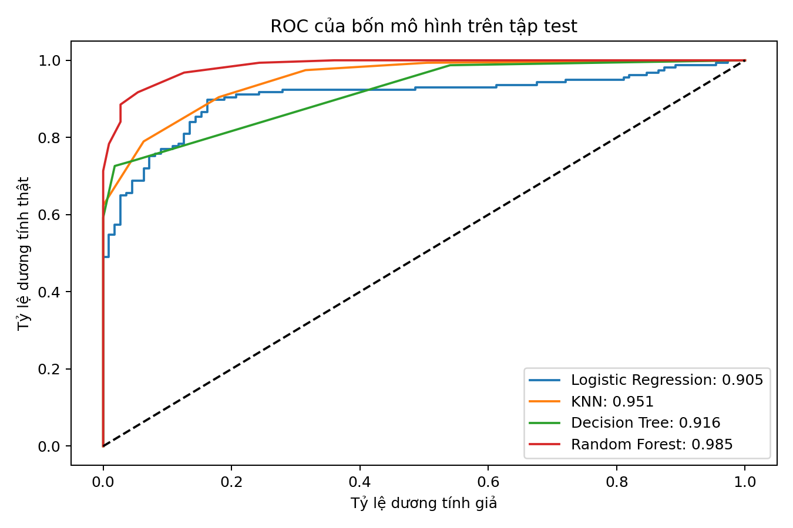

## MỞ ĐẦU

Tiểu luận phân tích Insurance Claim Dataset thuộc Project 3 của đề Mid-Term 2. Mục tiêu là mô tả dữ liệu, giải trình lựa chọn làm sạch, đối chiếu các giả định bằng số liệu và biểu đồ, sau đó đề xuất hướng ứng dụng phù hợp. Phần mô hình phân loại vận dụng bài thực hành học máy có giám sát trong tài liệu học phần. [1], [2]

Dữ liệu gốc có 1.338 dòng và 8 thuộc tính, không có giá trị thiếu. Sau khi bỏ một dòng lặp hoàn toàn theo quy ước phân tích, mẫu còn 1.337 dòng. Nhãn 1 chiếm 58,49%. Các quan sát BMI hoặc charges được IQR đánh dấu vẫn được giữ vì chưa xác định là lỗi. Cách xử lý này bảo toàn phần chi phí cao cần được xem xét trong phân tích bảo hiểm.

| Nội dung | Kết quả trong mẫu |
| --- | --- |
| Hút thuốc | Tỷ lệ nhãn 1: 90,88% ở smoker=1 và 50,14% ở smoker=0. |
| Tuổi và BMI | Tỷ lệ tăng theo nhóm BMI nhưng không tăng đều theo ba nhóm tuổi. |
| Chi phí | Trung vị charges của nhãn 1 cao hơn nhãn 0; thời điểm quan sát chưa rõ. |
| Mô hình | Random Forest đạt accuracy 92,16% trên 268 dòng test; vẫn bỏ sót 18 nhãn 1. |

Các kết luận được giới hạn trong bộ dữ liệu đang quan sát. Nhãn insuranceclaim chưa được chứng minh là kết quả xét duyệt hoặc chi trả thực tế. Vì vậy, báo cáo không dùng mô hình để tự động quyết định bồi thường, định phí hay kết luận về một cá nhân. Khuyến nghị trọng tâm là hoàn thiện dữ liệu và kiểm chứng trên nguồn độc lập trước khi ứng dụng.

## 1. THU THẬP VÀ ĐÁNH GIÁ DỮ LIỆU

### 1.1. Mục tiêu và nguồn dữ liệu

Bộ dữ liệu được lựa chọn đúng theo Project 3 trong đề, từ trang Kaggle yasserh/insurance-claim-dataset. Đầu vào là một tệp Insurance.csv gồm 1.338 quan sát và 8 cột. Không có bảng thứ hai hoặc khóa chính/khóa ngoại để ghép. Tệp gốc được giữ riêng, còn dữ liệu sau xử lý được xuất thành Insurance_clean.csv. [1]

Bài toán là phân tích mối liên hệ giữa các đặc điểm trong tệp với nhãn insuranceclaim và thử nghiệm phân loại hai nhãn. Dữ liệu không có nhãn gian lận, số tiền thực chi trả hoặc kết quả duyệt hồ sơ; do đó không thể đổi mục tiêu thành phát hiện gian lận hay dự báo bồi thường thực tế.

| Câu hỏi | Bằng chứng sử dụng |
| --- | --- |
| Dữ liệu có thiếu, trùng hoặc ngoại lệ không? | Kiểu dữ liệu, isna, duplicated, IQR và boxplot. |
| Hút thuốc, tuổi, BMI liên hệ với nhãn như thế nào? | Số lượng và tỷ lệ theo nhóm; biểu đồ cột và scatter plot. |
| Chi phí có khác nhau giữa hai nhãn không? | Trung bình, trung vị, boxplot và scatter plot. |
| Bốn mô hình cơ bản dự đoán ra sao? | Cùng tập train/test; accuracy, precision, recall, ma trận nhầm lẫn và ROC-AUC. |
| Có thể ứng dụng kết quả ở mức nào? | Đọc các phát hiện cùng sai số và giới hạn dữ liệu. |

Dữ liệu thiếu mã khách hàng/hợp đồng, thời điểm quan sát, thời điểm phát sinh yêu cầu và trạng thái xử lý hồ sơ. Vì vậy, không xác minh được các dòng thuộc người nào, cũng chưa biết đặc trưng nào thực sự sẵn có trước thời điểm dự đoán. Đây là giới hạn của nguồn dữ liệu, không phải lỗi có thể khắc phục bằng cách tự tạo thêm giá trị.

### 1.2. Thuộc tính và hiện trạng ban đầu

| Biến | Vai trò / ý nghĩa | Đơn vị hoặc mã |
| --- | --- | --- |
| age | Tuổi | Năm |
| sex | Giới tính theo mã của CSV | Mã 0/1 |
| bmi | Chỉ số khối cơ thể | kg/m² |
| children | Số con hoặc người phụ thuộc | Người |
| smoker | Tình trạng hút thuốc | 0 không; 1 có |
| region | Vùng cư trú theo mã của CSV | Mã 0, 1, 2, 3 |
| charges | Chi phí y tế theo mô tả nguồn | Đơn vị gốc; kỳ tính chưa xác minh |
| insuranceclaim | Nhãn yêu cầu bảo hiểm | 0 không; 1 có |

Tất cả cột được đọc dưới dạng số nhưng vai trò thống kê khác nhau: region là biến định tính danh nghĩa; sex, smoker và insuranceclaim là mã nhị phân; children là biến đếm. Kiểu int không tự làm cho một mã nhóm trở thành thang đo liên tục. Khi phân tích, các mã vùng được giữ đúng như tệp và không tự gán thứ tự định lượng.

| Kiểm tra | Kết quả |
| --- | --- |
| Cấu trúc | Một CSV; 1.338 dòng, 8 cột; không ghép bảng. |
| Giá trị thiếu | 0 ô NaN trong toàn bộ tệp. |
| Miền mã | sex, smoker, insuranceclaim thuộc {0,1}; region thuộc {0,1,2,3}. |
| Miền biến số | age 18-64; children 0-5; BMI 15,96-53,13; charges 1.121,87-63.770,43. |
| Dòng trùng | Hai dòng có cùng 8 giá trị, tương ứng chỉ số 195 và 581; một dòng lặp vượt bản đầu. |

Các kiểm tra xác nhận sự nhất quán kỹ thuật của tệp nhưng chưa xác nhận độ chính xác của khai báo, tính đại diện của mẫu hoặc cơ chế tạo nhãn. Việc không có giá trị thiếu cũng không đồng nghĩa bộ dữ liệu đã đủ mọi thông tin cần cho ứng dụng bảo hiểm.

## 2. TIỀN XỬ LÝ VÀ LÀM SẠCH DỮ LIỆU

### 2.1. Minh chứng dòng trùng và ngoại lệ

Trên 1.338 dòng gốc, quy tắc IQR đánh dấu 9 giá trị BMI và 139 giá trị charges; age và children không có giá trị vượt hàng rào IQR. Ngưỡng trên của BMI là 47,29 và của charges là 34.489,35. Đây là dấu hiệu để kiểm tra, chưa phải bằng chứng các quan sát bị nhập sai.

Boxplot của charges có đuôi phải dài và nhiều quan sát lớn. Việc xóa toàn bộ nhóm này có thể làm mất phần chi phí cao có ý nghĩa với bài toán bảo hiểm. Vì chưa có căn cứ xác định lỗi, phân tích chính giữ các quan sát được đánh dấu.

| Biến | Q1 | Q3 | Ngưỡng trên | Số đánh dấu |
| --- | --- | --- | --- | --- |
| age | 27,00 | 51,00 | 87,00 | 0 |
| bmi | 26,30 | 34,69 | 47,29 | 9 |
| children | 0,00 | 2,00 | 5,00 | 0 |
| charges | 4.740,29 | 16.639,91 | 34.489,35 | 139 |

IQR được tính bằng Q3 trừ Q1. Quan sát được đánh dấu khi nhỏ hơn Q1 - 1,5×IQR hoặc lớn hơn Q3 + 1,5×IQR. Phương pháp tạo bằng chứng có thể kiểm tra lại, nhưng không thay thế việc xác minh nghiệp vụ. Không dùng IQR để loại các mã smoker, sex, region hoặc nhãn. [2]

### 2.2. Lựa chọn xử lý và kiểm tra sau làm sạch

| Vấn đề | Quyết định và lý do |
| --- | --- |
| Giá trị thiếu | Không điền mean/median vì tệp không có ô thiếu. |
| Dòng trùng | Giữ bản đầu và bỏ một dòng trùng hoàn toàn trước khi chia train/test. |
| Ngoại lệ BMI và charges | Giữ lại vì chưa có bằng chứng là lỗi; tránh xóa thông tin về chi phí cao. |
| Mã vùng | One-hot region bằng get_dummies để tránh coi 0-3 là một thang đo. |
| Chuẩn hóa | Fit StandardScaler trên train, transform trên test; cần cho Logistic Regression và KNN. |
| Biến charges | Giữ trong phân tích mô tả; loại khỏi đặc trưng mô hình vì chưa rõ thời điểm quan sát. |

Dữ liệu còn 1.337 dòng, không còn dòng trùng hoàn toàn và vẫn có hai nhãn. Bỏ dòng lặp làm số nhãn 1 từ 783 còn 782, tỷ lệ từ 58,52% thành 58,49%, thay đổi -0,0310 điểm phần trăm. Sự thay đổi mô tả nhỏ nhưng việc bỏ trùng trước chia tập giúp tránh cùng một bản ghi giống hệt xuất hiện ở train và test.

Không có định danh để chứng minh hai dòng trùng là cùng một khách hàng. Bỏ một dòng là quy ước phân tích có giải trình, chưa phải kết luận về danh tính. Trong dữ liệu nghiệp vụ, cần khóa hồ sơ trước khi xác định cách khử trùng. Các bảng minh chứng được xuất cùng dữ liệu sạch để kiểm tra lại.

## 3. PHÂN TÍCH VÀ TRỰC QUAN HÓA

### 3.1. Phân bố nhãn và điểm mốc so sánh

Sau khi bỏ một dòng trùng, dữ liệu còn 1.337 bản ghi: 782 nhãn 1 (58,49%) và 555 nhãn 0 (41,51%). Nhãn 1 nhiều hơn nhưng dữ liệu vẫn có đủ hai lớp để chia train/test có phân tầng.

Trên tập test, cách luôn dự đoán nhãn 1 đã đạt accuracy 58,58%. Vì vậy, kết quả mô hình cần được đọc cùng precision, recall và ma trận nhầm lẫn; không chỉ nhìn accuracy.

Không diễn giải insuranceclaim=1 thành đã duyệt, đã chi trả hoặc gian lận. Hai nhãn chỉ được sử dụng theo định nghĩa yêu cầu bảo hiểm trong bài toán. Phân tầng khi chia tập giúp giữ tỷ trọng hai lớp gần với mẫu gốc; không tạo thêm bản ghi để cân bằng khi chưa có căn cứ cần thiết.

### 3.2. Phân bố các biến định lượng

Tuổi nằm trong 18-64, trung vị 39; BMI có trung vị 30,40, nhỏ nhất 15,96 và lớn nhất 53,13. Tuổi tập trung tương đối nhiều ở nhóm trẻ, còn children là biến đếm từ 0 đến 5.

charges có trung bình 13.279,12 nhưng trung vị chỉ 9.386,16, cho thấy phân bố lệch phải. Một số chi phí cao kéo trung bình lên. Khi mô tả hồ sơ điển hình cần đọc cả trung vị, miền giá trị và hình dạng phân phối. Đơn vị tiền tệ và kỳ tính chi phí chưa được xác minh từ tài liệu đầu vào.

| Biến | Trung bình | Trung vị | Nhỏ nhất | Lớn nhất |
| --- | --- | --- | --- | --- |
| age | 39,22 | 39,00 | 18,00 | 64,00 |
| bmi | 30,66 | 30,40 | 15,96 | 53,13 |
| children | 1,10 | 1,00 | 0,00 | 5,00 |
| charges | 13.279,12 | 9.386,16 | 1.121,87 | 63.770,43 |

### 3.3. Hút thuốc, tuổi, BMI và người phụ thuộc

Nhóm smoker=1 có 249/274 nhãn 1 (90,88%), so với 533/1063 (50,14%) ở nhóm smoker=0. Chênh lệch là 40,73 điểm phần trăm. Giả định về tỷ lệ cao hơn ở nhóm hút thuốc được số liệu mẫu ủng hộ.

Ba nhóm tuổi 18-29, 30-44 và 45-64 có tỷ lệ lần lượt 57,21%, 46,94% và 68,05%. Nhóm giữa có tỷ lệ thấp nhất; do đó giả định tỷ lệ tăng đều theo tuổi không phù hợp với cách phân nhóm này.

Tỷ lệ nhãn 1 tăng từ 19,59% ở BMI dưới 25 lên 84,62% ở BMI từ 40 trở lên. Các ngưỡng BMI chỉ phục vụ phân tích nhóm, không được dùng để chẩn đoán sức khỏe.

Nhóm children=0 có tỷ lệ 80,63%, trong khi children=3 đạt 28,66%. Tuy nhiên, nhóm children=4 và 5 chỉ có 25 và 18 quan sát; tỷ lệ tăng lại từ 16,00% lên 22,22%. Không nên suy ra một quy luật giảm tuyệt đối hoặc tác động bảo vệ của việc có thêm người phụ thuộc.

### 3.4. Mã giới tính và vùng cư trú

Mã region=2 có tỷ lệ cao nhất (67,31%), còn region=1 thấp nhất (50,00%). Chênh lệch có thể phản ánh cơ cấu tuổi, BMI hoặc hút thuốc khác nhau giữa các nhóm. Không dùng mã vùng như một thang đo số liên tục.

Nhóm sex=0 có 662 quan sát, tỷ lệ 56,95%; sex=1 có 675 quan sát, tỷ lệ 60,00%. Chênh lệch mô tả là 3,05 điểm phần trăm. Báo cáo chưa có kiểm định suy luận để kết luận khác biệt của tổng thể.

| region | Số bản ghi | Số nhãn 1 | Tỷ lệ nhãn 1 |
| --- | --- | --- | --- |
| 0 | 324 | 192 | 59,26% |
| 1 | 324 | 162 | 50,00% |
| 2 | 364 | 245 | 67,31% |
| 3 | 325 | 183 | 56,31% |

### 3.5. Chi phí y tế và giới hạn thời điểm thông tin

Trung vị charges của nhãn 1 là 11.552,36, cao hơn 6.933,24 của nhãn 0. Trung bình tương ứng là 16.442,83 và 8.821,42. Dù khác nhau về mức trung tâm, hai phân bố vẫn chồng lấn, nên một ngưỡng chi phí không phân tách hoàn toàn hai nhãn.

Scatter plot cho thấy quan hệ giữa BMI và chi phí khác nhau theo nhóm hút thuốc. Không nên diễn giải toàn bộ dữ liệu như một quan hệ tuyến tính duy nhất. charges được dùng để mô tả nhưng không đưa vào mô hình chính do bộ dữ liệu không cho biết chi phí được biết trước hay sau thời điểm phát sinh yêu cầu.

| Nhãn | Số bản ghi | Trung bình charges | Trung vị charges |
| --- | --- | --- | --- |
| 0 | 555 | 8.821,42 | 6.933,24 |
| 1 | 782 | 16.442,83 | 11.552,36 |

### 3.6. Quan sát đồng thời các đặc điểm

Scatter plot cho thấy hai nhãn xuất hiện ở nhiều nhóm tuổi và vẫn có vùng chồng lấn theo BMI. Vì vậy, không thể phân tách toàn bộ nhãn chỉ bằng một ngưỡng tuổi hoặc BMI. Nhận xét này cần được đọc cùng tỷ lệ theo nhóm ở Hình 4.

Boxplot cho thấy nhóm nhãn 1 tập trung ở số người phụ thuộc thấp hơn nhóm nhãn 0. Số liệu nhóm children=0 có tỷ lệ nhãn 1 là 80,63%, còn children=3 là 28,66%. Biểu đồ mô tả cấu trúc của mẫu, không chứng minh việc có thêm người phụ thuộc làm giảm yêu cầu bảo hiểm.

### 3.7. Đối chiếu các giả định ban đầu

Đề yêu cầu đối chiếu số liệu với các giả định ban đầu. Phần này sử dụng tỷ lệ, trung vị và biểu đồ đã trình bày để kiểm chứng mô tả. Các kết luận chưa phải kiểm định suy luận có p-value; không dùng các từ “bác bỏ H0” hoặc “có ý nghĩa thống kê” cho kết quả chỉ dựa trên mô tả.

| Giả định | Bằng chứng trong mẫu | Kết luận mô tả |
| --- | --- | --- |
| Hút thuốc có tỷ lệ nhãn 1 cao hơn | 90,88% so với 50,14%. | Được số liệu mẫu ủng hộ. |
| Tỷ lệ nhãn 1 tăng đều theo tuổi | 57,21%; 46,94%; 68,05%. | Không tăng đều theo ba nhóm đã chọn. |
| Nhóm BMI cao có tỷ lệ cao hơn | Từ 19,59% lên 84,62%. | Có xu hướng tăng theo các khoảng BMI. |
| Nhãn 1 có chi phí cao hơn | Trung vị 11.552,36 so với 6.933,24. | Mức trung tâm cao hơn, nhưng phân bố chồng lấn. |
| Hai mã giới có tỷ lệ khác nhau | 56,95% so với 60,00%. | Có chênh lệch mẫu; chưa suy ra tổng thể. |

Cùng một tập dữ liệu có thể cho các nhận xét đúng về mẫu nhưng chưa đủ để giải thích nguyên nhân. Các phân tích hai biến cũng chưa tách riêng ảnh hưởng của tuổi, BMI, hút thuốc và cơ cấu nhóm. Hướng ứng dụng cần bắt đầu bằng việc xác minh nhãn và thiết kế dữ liệu, không chỉ bổ sung thuật toán.

### 3.8. Thiết kế và kết quả bốn mô hình cơ bản

| Thành phần | Thiết lập |
| --- | --- |
| Biến đích và đặc trưng | insuranceclaim; age, bmi, children, sex, smoker, region; không dùng charges. |
| Mã hóa | get_dummies cho region; bỏ cột mã gốc; giữ một nhóm làm mốc. |
| Train/test | 80/20; random_state=42; stratify theo nhãn; 1.069 train và 268 test. |
| Chuẩn hóa | Học mean/std trên train; chỉ transform trên test; cùng bộ dữ liệu cho bốn mô hình. |
| Logistic Regression và KNN | Logistic Regression random_state=42; KNN n_neighbors=5. |
| Cây và Random Forest | Decision Tree max_depth=3; Random Forest n_estimators=10; random_state=42. |

Thiết lập bám bài thực hành tuần 15. Chỉ fit bộ chuẩn hóa trên train và không sửa tham số sau khi xem test. StandardScaler cần cho Logistic Regression và KNN; mô hình cây không cần chuẩn hóa nhưng dùng cùng dữ liệu để thống nhất quy trình. [2]

| Mô hình | Accuracy | Precision 1 | Recall 1 | ROC-AUC |
| --- | --- | --- | --- | --- |
| Logistic Regression | 0,8619 | 0,8704 | 0,8981 | 0,9049 |
| KNN | 0,8694 | 0,8765 | 0,9045 | 0,9509 |
| Decision Tree | 0,8321 | 0,9828 | 0,7261 | 0,9158 |
| Random Forest | 0,9216 | 0,9789 | 0,8854 | 0,9849 |

Random Forest có accuracy cao nhất trong bốn mô hình ở lần chia này (92,16%), trong khi KNN có recall nhãn 1 cao hơn (90,45% so với 88,54%). Đây là những đánh đổi khác nhau. Kết quả trên một tập test chưa đủ để khẳng định ưu thế ổn định của một thuật toán hoặc tự động chọn ngưỡng nghiệp vụ.

### 3.9. Phân tích sai số bằng ma trận nhầm lẫn

Hàng của mỗi ma trận là nhãn thực tế, cột là nhãn dự đoán. Với Random Forest, TN=108, FP=3, FN=18 và TP=139: mô hình dự đoán đúng 247/268 trường hợp nhưng vẫn bỏ sót 18 nhãn 1. Logistic Regression bỏ sót 16, KNN bỏ sót 15, còn cây sâu 3 bỏ sót 43.

Decision Tree có precision nhãn 1 cao (98,28%) nhưng recall chỉ 72,61%, cho thấy ít dự đoán nhầm nhãn 1 song bỏ sót nhiều trường hợp. KNN có recall 90,45% nhưng dự đoán nhầm 20 nhãn 0. Lựa chọn mô hình cho nghiệp vụ cần biết chi phí của FP và FN, chưa thể chỉ dựa vào một điểm số.

| Mô hình | TN | FP | FN | TP |
| --- | --- | --- | --- | --- |
| Logistic Regression | 90 | 21 | 16 | 141 |
| KNN | 91 | 20 | 15 | 142 |
| Decision Tree | 109 | 2 | 43 | 114 |
| Random Forest | 108 | 3 | 18 | 139 |

### 3.10. ROC và khả năng khái quát hóa

Random Forest đạt ROC-AUC 0,9849, cao nhất trong bốn mô hình ở lần chia này; KNN đạt 0,9509 và cây sâu 3 đạt 0,9158. Đường chéo thể hiện mốc xếp hạng ngẫu nhiên. AUC phản ánh khả năng xếp hạng theo xác suất, khác với accuracy tại ngưỡng dự đoán mặc định.

Random Forest đạt accuracy train 100% nhưng accuracy test 92,16%. Khoảng cách này cho thấy cần thận trọng về khả năng khái quát hóa. Kết quả chỉ là so sánh nội bộ với một lần chia train/test, chưa xác nhận mô hình tốt nhất trên dữ liệu bảo hiểm độc lập.

| Mô hình | Accuracy train | Accuracy test | Chênh lệch |
| --- | --- | --- | --- |
| Logistic Regression | 89,62% | 86,19% | 3,42 điểm % |
| KNN | 92,42% | 86,94% | 5,48 điểm % |
| Decision Tree | 85,31% | 83,21% | 2,10 điểm % |
| Random Forest | 100,00% | 92,16% | 7,84 điểm % |

Tham số được giữ cố định theo tài liệu. Cần tập kiểm tra độc lập và thông tin chi phí FP/FN trước khi lựa chọn mô hình cho ứng dụng thực tế.

## 4. ĐÁNH GIÁ TÁC ĐỘNG VÀ KHUYẾN NGHỊ

### 4.1. Phát hiện và hướng ứng dụng

| Phát hiện | Hành động đề xuất | Thông tin cần bổ sung |
| --- | --- | --- |
| Dữ liệu nhất quán nhưng thiếu định danh và thời gian | Chuẩn hóa từ điển, mã hồ sơ và nhật ký cập nhật. | Mã khách hàng, hợp đồng, thời điểm đo biến và yêu cầu. |
| Hút thuốc và BMI liên hệ với nhãn trong mẫu | Đặt câu hỏi nghiệp vụ và kiểm chứng trên dữ liệu độc lập. | Cách xác thực khai báo, cơ chế gán nhãn. |
| Tỷ lệ khác nhau theo nhóm tuổi và vùng | Đọc cùng cỡ mẫu và cơ cấu nhóm. | Mẫu độc lập đủ lớn; các yếu tố liên quan. |
| Mô hình còn FP và FN | Thử nghiệm hỗ trợ sắp xếp hồ sơ có người xem xét. | Chi phí sai số, năng lực xử lý, ngưỡng ưu tiên. |
| charges chưa rõ thời điểm | Chỉ dùng đặc trưng sẵn có trước lúc dự đoán. | Thời gian phát sinh và hoàn tất chi phí. |

Một thử nghiệm ứng dụng có thể so sánh thời gian xử lý, tỷ lệ hồ sơ cần xem xét lại, số trường hợp bỏ sót và chi phí vận hành với quy trình hiện hành. Đây là chỉ tiêu cần thu thập trong thử nghiệm, chưa phải lợi ích đã được chứng minh bởi bộ dữ liệu. Báo cáo không đưa ra con số tiết kiệm, doanh thu tăng hoặc ngân sách bồi thường giả định.

Các nhóm hút thuốc và BMI được dùng cho phân tích thống kê. Kết quả không tạo căn cứ trực tiếp để chẩn đoán, từ chối yêu cầu hay định phí cá nhân. Mọi quyết định nghiệp vụ cần được xem xét bằng dữ liệu phù hợp, quy tắc của hợp đồng và trách nhiệm của người xử lý.

### 4.2. Giới hạn và hướng mở rộng

| Giới hạn | Ảnh hưởng đến kết luận |
| --- | --- |
| Cơ chế gán nhãn chưa rõ | Hiệu suất có thể phản ánh cấu trúc của dữ liệu mẫu; chưa xác nhận hồ sơ thực. |
| Thiếu định danh và thời gian | Chưa chia tập theo khách hàng hoặc thời gian; chưa xác minh thời điểm đặc trưng. |
| Một số nhóm nhỏ | Tỷ lệ children=4 hoặc 5 dễ biến động do chỉ có 25 và 18 dòng. |
| Một lần chia train/test | Chưa đánh giá độ ổn định của điểm số qua các mẫu độc lập. |
| Phân tích giả định theo mô tả | Chưa có kiểm định suy luận để kết luận khác biệt của tổng thể. |
| Thiếu biến hợp đồng và đơn vị chi phí | Chưa quy đổi sang định phí, thiệt hại hoặc ngân sách bồi thường. |

Ưu tiên mở rộng là xác minh định nghĩa nhãn và nguồn gốc dữ liệu, sau đó thu thập hồ sơ có định danh và dấu thời gian. Khi có nguồn độc lập, tiếp tục đánh giá sai số và mức hữu ích trong quy trình xử lý thực tế. Việc bổ sung phương pháp phải xuất phát từ câu hỏi nghiệp vụ và phạm vi kiến thức được phép sử dụng.

## KẾT LUẬN

Tiểu luận đã triển khai bốn giai đoạn của đề Mid-Term 2: đánh giá dữ liệu ban đầu, tiền xử lý có giải trình, phân tích và trực quan hóa, cuối cùng là đánh giá tác động và đề xuất khuyến nghị. Tệp gốc có 1.338 dòng và 8 thuộc tính; sau khi bỏ một dòng trùng còn 1.337 dòng. Không điền giá trị thiếu hoặc xóa ngoại lệ khi dữ liệu không cung cấp căn cứ cho các thao tác đó.

Phân tích cho thấy nhóm hút thuốc có tỷ lệ nhãn 1 cao hơn nhóm không hút thuốc; tỷ lệ tăng theo các khoảng BMI nhưng không tăng đều theo tuổi. Nhãn 1 có charges trung vị cao hơn nhãn 0. Các phát hiện giúp đặt câu hỏi về cấu trúc của bộ dữ liệu nhưng chưa chứng minh tác động nhân quả hoặc kết luận cho thị trường bảo hiểm.

Với các mô hình và tham số trong tài liệu học phần, Random Forest đạt accuracy 92,16% trên 268 dòng test, dự đoán đúng 247 trường hợp và bỏ sót 18 nhãn 1. KNN có recall cao hơn nhưng cũng dự đoán nhầm nhiều nhãn 0 hơn. Vì thế, mô hình chỉ nên được xem là thử nghiệm phân loại nội bộ; hướng ứng dụng tiếp theo cần dữ liệu độc lập và định nghĩa rõ chi phí sai số.

## TÀI LIỆU THAM KHẢO

[1] M Yasser H. Insurance Claim Dataset. Kaggle. Bộ dữ liệu được chỉ định trong đề Project 3; tệp Insurance.csv do người học cung cấp.

<link href="https://www.kaggle.com/datasets/yasserh/insurance-claim-dataset" color="#000000">https://www.kaggle.com/datasets/yasserh/insurance-claim-dataset</link>

[2] Tài liệu học phần do người học cung cấp: Mid-term-2.pdf; T6 và T7 nhập và lưu trữ dữ liệu; T8 và T9 làm sạch và chuẩn bị dữ liệu; T10 và T11 sắp xếp và biến đổi dữ liệu; T12 và T13 trực quan hóa dữ liệu; T14 và T15 các mô hình học máy có giám sát; các bài lập trình cơ bản, rẽ nhánh và vòng lặp.

Các bảng, hình và điểm số trong báo cáo được tính từ Insurance.csv bằng notebook và script của dự án. Bảng Doi_chieu_tai_lieu.md ghi tài liệu và ô tương ứng cho các thao tác chính. Không sử dụng kết quả mô hình của dự án khác để thay cho kết quả thực thi của bài này.

## PHỤ LỤC TÁI LẬP VÀ ĐỐI CHIẾU YÊU CẦU

| Yêu cầu | Vị trí và tệp đáp ứng |
| --- | --- |
| Nguồn, thuộc tính, quy mô và hiện trạng | Chương 1; Insurance.csv; Bang01_Kiem_tra_du_lieu.csv. |
| Minh chứng và giải trình làm sạch | Chương 2; Hình 1; Bang02_Dong_trung.csv; Bang03_Ngoai_le_IQR.csv. |
| Đối chiếu giả định và diễn giải từng hình | Chương 3; Hình 2-9; các bảng nhóm và chi phí; diễn giải trong notebook. |
| Tác động, khuyến nghị và giới hạn | Chương 4 và kết luận. |
| Notebook có chú thích từng khối | Project3_MidTerm2.ipynb gồm 15 ô mã, mỗi ô có chú thích và mô tả. |
| Mã tương đương và kết quả đồng bộ | analysis.py; outputs/; nhật ký xác minh notebook và script cho cùng kết quả. |
| GitHub công khai và URL trong báo cáo | https://github.com/duyta848-sys/Project3-Insurance-Claim; notebook, PDF và dữ liệu nằm ở thư mục gốc của bộ file để tải lên kho nhóm. |

Cách chạy notebook: mở Project3_MidTerm2.ipynb trên Colab rồi chọn Run all. Notebook chứa nguyên văn CSV gốc trong ô đọc dữ liệu để chạy độc lập. Mỗi khối lệnh có chú thích, các hình đi kèm phần giải thích số liệu. Có thể thay ô đọc dữ liệu bằng read_csv với URL raw của Insurance.csv sau khi tải lên GitHub.

Script analysis.py đọc Insurance.csv trong cùng thư mục và xuất bảng/hình vào thư mục làm việc. Thư mục outputs trong bộ nộp chứa các kết quả đã được tạo bằng cùng quy trình. Báo cáo Word được cung cấp để chỉnh bìa; PDF là bản trình bày chính thức. Tệp ZIP chứa đúng các phiên bản đã đồng bộ.